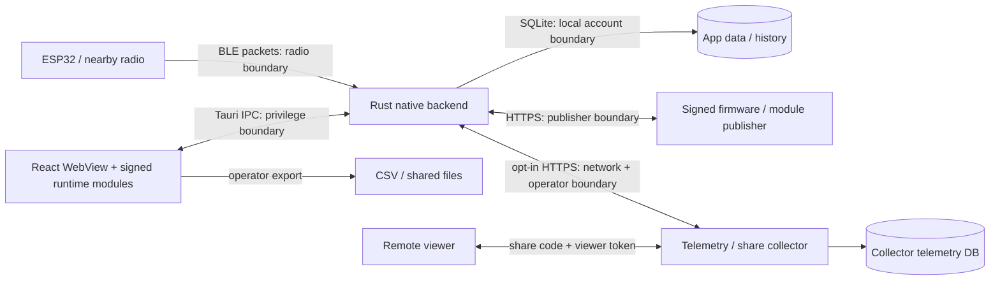

# IRMS research deployment threat model

Scope: source review of b3012f0 and the R05 benchmark additions on 2026-10-29.
Follow-ups: S02 collector revocation fixed at fd66f2d; S01 native response limits validated
against fd66f2d with local HTTP tests. These source fixes are not production deployment evidence.
S03 ownership-v1 adds native-only collector-scoped proof, transactional first-ingest binding,
digest-only storage and fail-closed version checks; validated locally against baseline f039457.
This is a design and code assessment, not an audit of the running hina-tw.ddns.net service.
No credentials, participant records or production configuration were inspected.

Updater follow-up (2026-10-30 baseline275336c): shared owner-bound synchronous transition lease
interlocks native session creation, idle close and install launch before awaits. Existing active/
retained-id guards remain; successful installer handoff keeps new collection blocked until process
exit, while explicit rejection releases for retry. This protects cooperative renderer ordering,
not external process attestation: rejected install may still have launched an installer and resolved
install does not prove application exit. Native Windows installer/termination remains unverified.

Normal-close follow-up (baselinee1ad348): application-lifetime close listener blocks native
destruction with pending start/end or retained session data; idle reservation prevents racing start.
Failed registration blocks new sessions, failed destruction releases reservation. Narrow main-window
allow-destroy capability enables the installed API's explicit native destruction path. This is a
cooperative lifecycle control in the trusted renderer, not a renderer security sandbox or durability
boundary. Native event delivery remains unverified; compromised/crashed/hung renderer, forced kill
and OS termination remain outside this protection.

Storage follow-up (baseline157a4f7): shared JSON limits native append batches to1000 rows,
timestamps128 UTF-8 bytes and finite six angle/roll fields before acquiring the DB lock. This occurs
after Tauri Vec deserialization; it bounds per-command DB work, not wire/parse heap/database size.
Controller tracks buffer plus unacknowledged in-flight suffix, stops acquisition at2000 pending
before accepting another frame and preserves all accepted samples for existing save retry.
Acknowledged chunks retire individually. Crash loss, commit-with-lost-reply duplication and hung
native writes remain residual risks; finite numbers do not prove physiological validity.
Method: identify the system, what can go wrong, responses and verification; describe processes,
stores and trust boundaries following the [OWASP threat-modeling guidance](https://cheatsheetseries.owasp.org/cheatsheets/Threat_Modeling_Cheat_Sheet.html).

## Assets, actors and boundaries

Assets: movement/session integrity, calibration and personal angle limits, local history/exports,
telemetry packets, live state, share capability tokens, update signing authority and device availability.
Actors include the local operator, nearby untrusted BLE transmitters, remote viewers, public ingest
clients, collector/read-token administrators and first-party module/update publishers. A compromised
local account or signing authority is more privileged than a remote unauthenticated client.

The renderer and loaded modules share a JavaScript realm. A module capability object is an API
convention, not a hostile-code sandbox. Signing proves publisher authorization, not code safety.
BLE identity, movement accuracy and radio confidentiality are not established by lifecycle fencing.

## Controls and residual risks

| Boundary / source | Existing source control | Residual risk / concrete verification |
| --- | --- | --- |
| BLE -> native: `ble.rs`, `ble_lifecycle.rs` | Packet parsing and epoch-gated dispatch; serialized connect/cleanup ownership; finite-value/format handling and connection error paths | Nearby spoofing/unauthorized devices, radio replay and physical cleanup failure require owned-device testing. Receiver time cannot prove source freshness or anatomical correctness. Run synchronized raw/reference captures and stale/corrupted packet acceptance tests. |
| Renderer -> IPC: `src-tauri/src/lib.rs`, `capabilities/default.json`, `tauri.conf.json` | Explicit command registration; limited standard plugin permissions; CSP restricts renderer network; asset scope limited to module JS directory | CSP is defense in depth, not complete authorization. XSS or malicious signed modules execute in the trusted renderer realm. Audit each custom command's argument/path/size validation and module privileges; test actual packaged WebView. Inline styles remain allowed. |
| Native -> local history: `db.rs` | Parameterized statements, transactional batch inserts, foreign keys, WAL and migrations; session end verifies affected row | Plain local SQLite and exported CSV contain sensitive research data. OS-account access, backups, retention and export handling require an institution-specific operating policy. No at-rest encryption or crash-durable pending-save claim. |
| Publisher -> native -> module/firmware: `modules.rs`, `firmware_update.rs`, `services/modules.ts` | Signed metadata, artifact hash and verified size; bounded metadata/signature/chunk downloads; module rollback check and verified-cache fallback | Key compromise/publisher compromise remains trusted-code risk. Verify key custody, rotation/revocation and offline/tamper/rollback behavior. Firmware authenticity does not establish clinical suitability or safe OTA interruption. |
| App -> collector: `telemetry.rs` | Default OFF, HTTPS except localhost; event/count/serialized byte caps, separate uploader, endpoint/enable generation purge and stale-result isolation | Already-issued requests cannot be recalled. Operator consent must explain recipient, raw data and retention. Redirect/destination policy and deployment TLS/access logs need separate review. Serialized bounds are not a process-memory ceiling. |
| Public clients -> collector: `IRMS_Telemetry/server.mjs` | 4 MiB body cap, batch/per-IP limits, storage cap; trusted-proxy XFF handling; read Bearer token with timing-safe equal-length comparison; configured retention | Public ingest authenticates no device and can contain fabricated events. runId/seq deduplication does not prove provenance. Defaults (120 requests/30,000 events per IP per minute, 20 GiB, 90 days) are source defaults, not verified deployment values. Validate proxy identity, retention execution, shared-NAT behavior, aggregate abuse and disk response. |
| Host/viewer -> live-share: `share.mjs`, `live_share.rs`, `services/liveShareHost.ts` | Separate host/viewer tokens, viewers initially read-only, expiry and per-IP budgets; host rejects changes while a session runs, validates finite values and clamps parameters; S01 incoming bounds, S02 revocation and S03 run ownership fixed locally | Review code-sharing/consent, authorization revocation and concurrent commands independently of visual UI; local fixes still require coordinated native/collector rollout and actual module/client acceptance. |

## Prioritized follow-up from independent security review

| ID | Priority | Verified source scenario | Next acceptance |
| --- | --- | --- | --- |
| S01 | Fixed locally / native acceptance open | Baseline command accepted cumulative chunked response beyond 64 KiB; regression reproduced. | All statuses now enforce 64 KiB declared/accumulated response cap before buffer extension. Local chunked/close-delimited/header-only/exact-limit/error/Unicode/truncation tests and independent review pass. Request budget and status/JSON/null contract retained. Not an exact heap ceiling; native packaged/deployment acceptance open. |
| S02 | Fixed locally / deployment open | Reproduced removed viewer's pending poll receiving the next state (200 instead of 401). | Removal/leave/expiry now revoke then wake that viewer's polls; completion rechecks Map identity and returns 401 without state. Ten local service tests pass, including multiple polls, other-viewer isolation and share-close cleanup. Production deployment not performed. |
| S03 | Fixed locally / rollout and client acceptance open | Reproduced runId-only creation returning 200 without ownership. Native now adds a collector-scoped per-launch proof header on ingest/create; first ingest transaction binds only its digest, and wrong/missing proof cannot mutate an owned run or replace its share. Legacy runs cannot be claimed later. | Real collector HTTP/SQLite/restart/rollback/retention tests, native bridge/generation/redirect/timeout tests and independent reviews pass. Capability/version markers reject old collectors; no proof in status/events/read APIs. Coordinated native+collector rollout and actual runtime-module/client acceptance still open. First-writer preclaim can cause denial of service; this is not device attestation. |

These were independently reported and lead-confirmed by reading the actual call paths. S01/S02/S03
have failing-before/passing-after local regressions and independent reviews. All still require the
appropriate native/deployment acceptance; no production exploitation was performed.
Other residual risks are review/acceptance items, not claims of demonstrated exploits.

## Verification and decision gates

R01/R02/R03/R04/R08 focused checks cover holds, downloads, confirmation DOM behavior, notifications
and connect orchestration. R05 adds synthetic production-path performance observations; see
[performance protocol and result](performance/README.md). These do not certify full-system security.

Before an institutional deployment, record the actual institution/country, data controller and
recipient, intended users, protocol, threat owner and acceptance evidence. Verify network/proxy,
authorization/revocation, update supply chain, storage/backup/retention and native accessibility on
the intended client. Human research and population suitability require the institution's own review
and appropriately designed evidence. Do not infer consent or suitability from age, sex, gender or
ethnicity; use individual measured limits and documented exclusions.

## History review read boundary (2026-10-29)

sessions_get_review is an additive local IPC read under the existing DB lock. One statement snapshot
feeds bounded1,200-point chart and all timestamp/kneeAngle/proximalAngle analysis rows. It adds no
network endpoint, mutation, database schema or general filesystem access. Old full getData/export
remain available. Projection reduces returned fields/serialized bytes, not a confidentiality boundary.
Full analysis still scales with session length and has no total byte/heap ceiling; native UI/IPC/memory
and unusually long-session acceptance remain open. Renderer discards obsolete results/errors but
cannot cancel native reads already issued. Timestamp validity semantics were preserved, not repaired
or elevated to measurement acceptance. See performance/history-review-projection.md for exact scope.

## History list page boundary (2026-10-29)

sessions_list_page is an additive local read command using the existing DB lock and a read
transaction. Native page size clamps1..100; bound/clamp precedes offset arithmetic. Migration10
adds a nonunique sorting index without rewriting session data. Response count/page belong to one
snapshot; separate pages can shift under concurrent writes. Old full list/review/export remain.
This row-count cap does not bound calibration text bytes, COUNT/deep-OFFSET CPU or total heap.
Renderer fences obsolete results/errors and preserves active-session deletion checks; deletion
failures are caught without optimistic data loss. No new network, general file or mutation authority.
