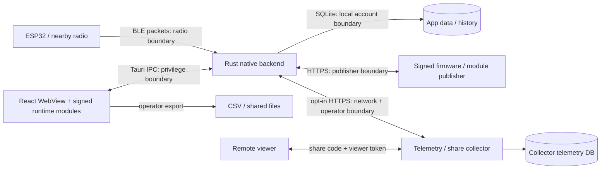

# IRMS research deployment threat model

Scope: source review of b3012f0 and the R05 benchmark additions on 2026-10-29.
This is a design and code assessment, not an audit of the running hina-tw.ddns.net service.
No credentials, participant records or production configuration were inspected.
Method: identify the system, what can go wrong, responses and verification; describe processes,
stores and trust boundaries following the [OWASP threat-modeling guidance](https://cheatsheetseries.owasp.org/cheatsheets/Threat_Modeling_Cheat_Sheet.html).

## Assets, actors and boundaries

Assets: movement/session integrity, calibration and personal angle limits, local history/exports,
telemetry packets, live state, share capability tokens, update signing authority and device availability.
Actors include the local operator, nearby untrusted BLE transmitters, remote viewers, public ingest
clients, collector/read-token administrators and first-party module/update publishers. A compromised
local account or signing authority is more privileged than a remote unauthenticated client.

The renderer and loaded modules share a JavaScript realm. A module capability object is an API
convention, not a hostile-code sandbox. Signing proves publisher authorization, not code safety.
BLE identity, movement accuracy and radio confidentiality are not established by lifecycle fencing.

## Controls and residual risks

| Boundary / source | Existing source control | Residual risk / concrete verification |
| --- | --- | --- |
| BLE -> native: `ble.rs`, `ble_lifecycle.rs` | Packet parsing and epoch-gated dispatch; serialized connect/cleanup ownership; finite-value/format handling and connection error paths | Nearby spoofing/unauthorized devices, radio replay and physical cleanup failure require owned-device testing. Receiver time cannot prove source freshness or anatomical correctness. Run synchronized raw/reference captures and stale/corrupted packet acceptance tests. |
| Renderer -> IPC: `src-tauri/src/lib.rs`, `capabilities/default.json`, `tauri.conf.json` | Explicit command registration; limited standard plugin permissions; CSP restricts renderer network; asset scope limited to module JS directory | CSP is defense in depth, not complete authorization. XSS or malicious signed modules execute in the trusted renderer realm. Audit each custom command's argument/path/size validation and module privileges; test actual packaged WebView. Inline styles remain allowed. |
| Native -> local history: `db.rs` | Parameterized statements, transactional batch inserts, foreign keys, WAL and migrations; session end verifies affected row | Plain local SQLite and exported CSV contain sensitive research data. OS-account access, backups, retention and export handling require an institution-specific operating policy. No at-rest encryption or crash-durable pending-save claim. |
| Publisher -> native -> module/firmware: `modules.rs`, `firmware_update.rs`, `services/modules.ts` | Signed metadata, artifact hash and verified size; bounded metadata/signature/chunk downloads; module rollback check and verified-cache fallback | Key compromise/publisher compromise remains trusted-code risk. Verify key custody, rotation/revocation and offline/tamper/rollback behavior. Firmware authenticity does not establish clinical suitability or safe OTA interruption. |
| App -> collector: `telemetry.rs` | Default OFF, HTTPS except localhost; event/count/serialized byte caps, separate uploader, endpoint/enable generation purge and stale-result isolation | Already-issued requests cannot be recalled. Operator consent must explain recipient, raw data and retention. Redirect/destination policy and deployment TLS/access logs need separate review. Serialized bounds are not a process-memory ceiling. |
| Public clients -> collector: `IRMS_Telemetry/server.mjs` | 4 MiB body cap, batch/per-IP limits, storage cap; trusted-proxy XFF handling; read Bearer token with timing-safe equal-length comparison; configured retention | Public ingest authenticates no device and can contain fabricated events. runId/seq deduplication does not prove provenance. Defaults (120 requests/30,000 events per IP per minute, 20 GiB, 90 days) are source defaults, not verified deployment values. Validate proxy identity, retention execution, shared-NAT behavior, aggregate abuse and disk response. |
| Host/viewer -> live-share: `share.mjs`, `live_share.rs`, `services/liveShareHost.ts` | Separate host/viewer tokens, viewers initially read-only, expiry and per-IP budgets; host rejects changes while a session runs, validates finite values and clamps parameters | Three confirmed source-level gaps below need focused regressions and fixes. Review code-sharing/consent, authorization revocation and concurrent commands independently of visual UI. |

## Prioritized follow-up from independent security review

| ID | Priority | Verified source scenario | Next acceptance |
| --- | --- | --- | --- |
| S01 | High | `live_share.rs::live_share_request` reads the whole response with `.text()` after bounding only the outgoing body. A configured or compromised collector can return an arbitrarily large body. | Cap declared and accumulated response bytes before buffer extension; local chunked/close-delimited/exact-limit/error-status tests. Do not depend on Content-Length alone. |
| S02 | Fixed locally / deployment open | Reproduced removed viewer's pending poll receiving the next state (200 instead of 401). | Removal/leave/expiry now revoke then wake that viewer's polls; completion rechecks Map identity and returns 401 without state. Ten local service tests pass, including multiple polls, other-viewer isolation and share-close cleanup. Production deployment not performed. |
| S03 | Medium | `share.mjs::create` uses live runId alone to create/replace a share. A telemetry reader who knows that runId can replace the original share without its host token. There is no finding that public callers can enumerate runIds. | Design independent per-run owner proof and require existing host proof for replacement; preserve client compatibility explicitly. A run identifier must not silently become an ownership secret. |

These were independently reported and lead-confirmed by reading the actual call paths. S02 now has
a failing-before/passing-after local regression and independent diff review. S01/S03 remain open for
the next bounded security batches. No production exploitation was performed.
Other residual risks are review/acceptance items, not claims of demonstrated exploits.

## Verification and decision gates

R01/R02/R03/R04/R08 focused checks cover holds, downloads, confirmation DOM behavior, notifications
and connect orchestration. R05 adds synthetic production-path performance observations; see
[performance protocol and result](performance/README.md). These do not certify full-system security.

Before an institutional deployment, record the actual institution/country, data controller and
recipient, intended users, protocol, threat owner and acceptance evidence. Verify network/proxy,
authorization/revocation, update supply chain, storage/backup/retention and native accessibility on
the intended client. Human research and population suitability require the institution's own review
and appropriately designed evidence. Do not infer consent or suitability from age, sex, gender or
ethnicity; use individual measured limits and documented exclusions.
