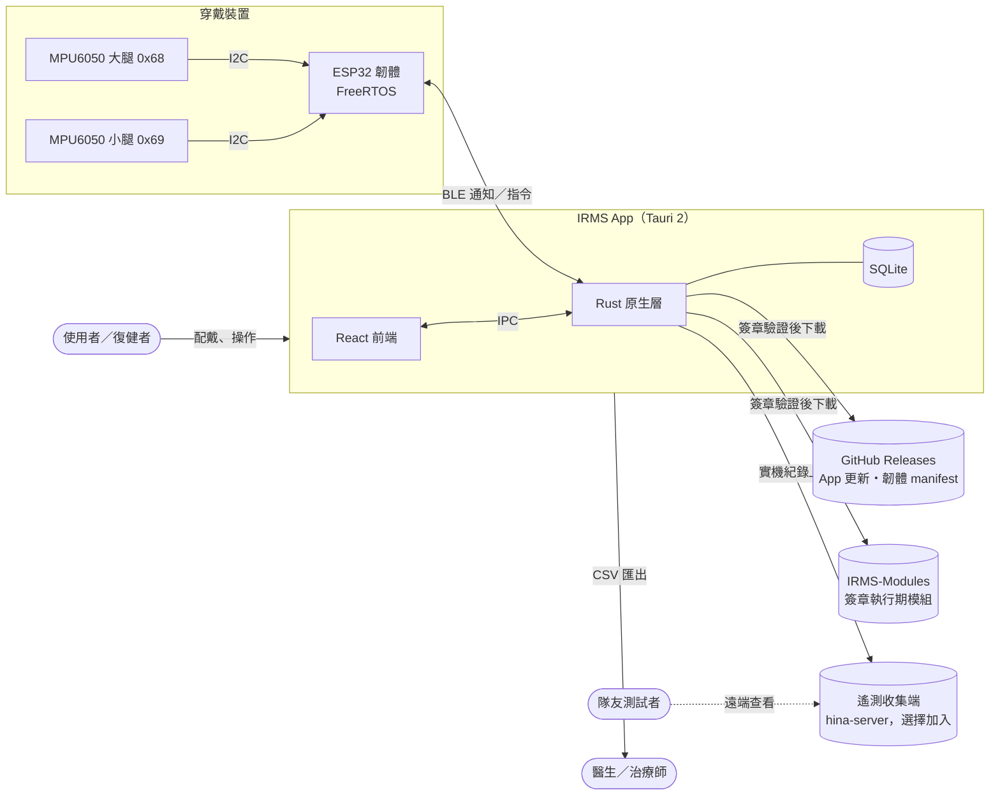
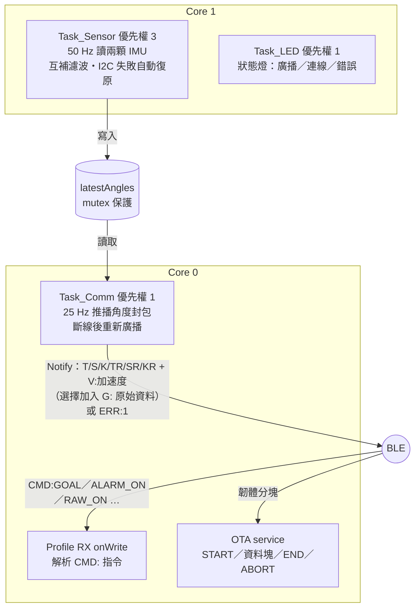
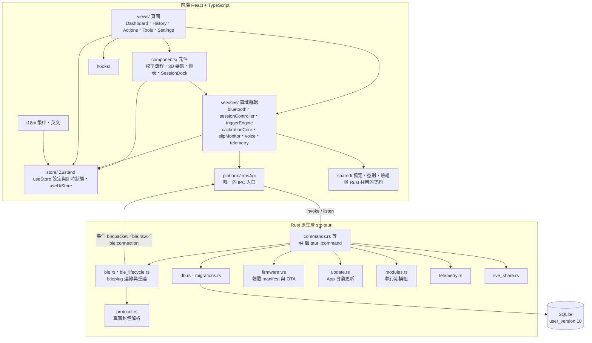
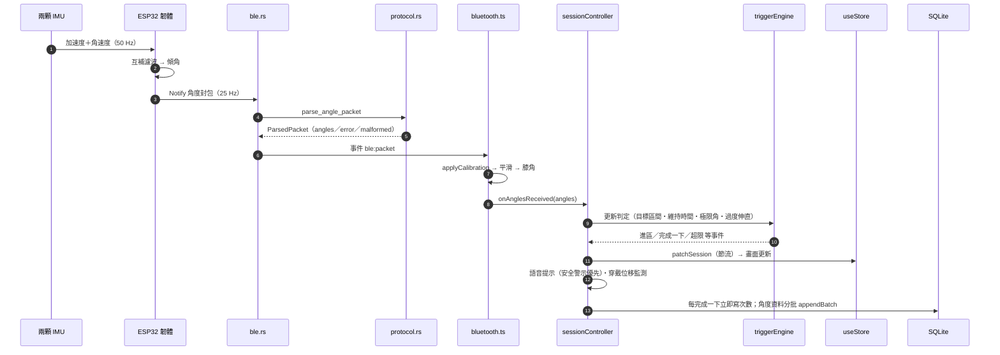
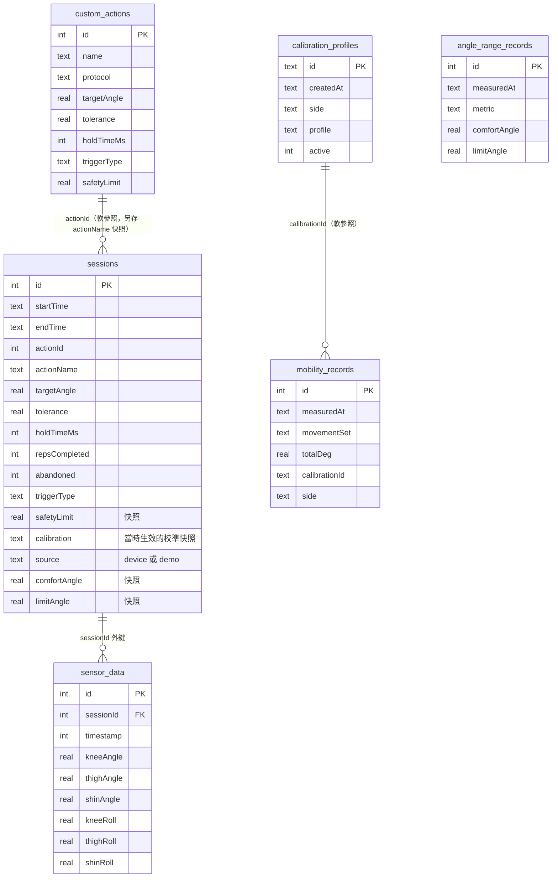
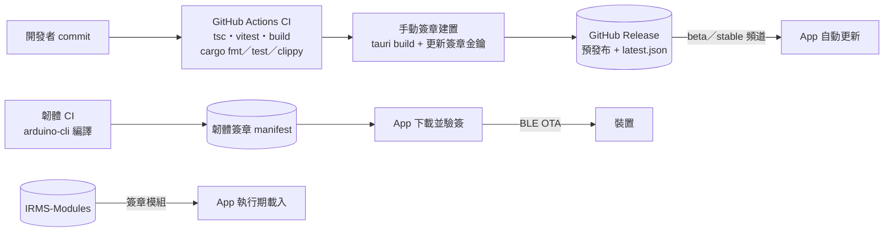

# IRMS 系統架構

> 以 2026-11-12 的程式碼為準（App `1.2.0-beta.26` 候選、韌體 `1.0.1-beta.2`、資料庫 `user_version = 10`）。
> 依專案決策 D2「程式碼優先於文件」：兩者不一致時修文件。
> 視覺化的總覽另見 [[IRMS_架構圖.canvas|Obsidian Canvas]]。
> 每張圖都另存 PNG 在 `doc/architecture/img/`（報告、投影片、學習歷程可直接使用）；修改圖後用 Mermaid 重新輸出。

## 1. 系統脈絡

誰在用、資料從哪裡來、往哪裡去。

- **判定全部在 App 端**（決策 D1）：韌體只負責量測與傳輸，不做任何計次或警示判斷。
- **平台**：Windows 桌面與 Android（同一份程式碼）；iOS 暫停。
- 裝置自 2026-09-27 起沒有實體蜂鳴器／LED，App 仍會送 `CMD:` 指令（相容），但**警示靠畫面與語音**。

## 2. 韌體（IRMS_Sensor）

| 項目 | 值 |
|---|---|
| 取樣／推播 | 50 Hz 取樣，25 Hz 推播（每 40 ms） |
| BLE MTU | 要求 128；OTA 在 MTU 不足時直接拒絕（`MTU_TOO_SMALL`） |
| 封包最長 | 角度封包約 105 bytes、`G:` 原始封包上限 112 bytes，都在 125 bytes 承載內 |
| 韌體更新 | BLE OTA，雙分割區（失敗仍跑舊韌體，不會變磚） |

## 3. App 分層

依賴規則（2026-11-12 以靜態分析確認）：

- 前端 85 個模組，**沒有執行期循環依賴**。
- `platform/irmsApi.ts` 是前端呼叫原生層的唯一入口；元件不直接 `invoke`。
- `shared/` 是與 Rust、韌體共用的契約，不依賴任何上層。
- 頁面只能被 `App.tsx` 載入（延遲載入），其他層不得 import `views/`。

## 4. 即時資料流（一個封包的一生）

- 真實裝置的封包在 **Rust 端解析**；TS 的 `parseAnglePacket` 用在模擬器與示範模式，`G:` 原始封包只在 TS 解析。
- 兩個解析器共用 `fixtures/angle-packets.json`、`fixtures/vector-packets.json` 測試案例；事件的 JSON 欄位名稱另由 Rust 的 wire-shape 測試鎖住（見第 7 節）。
- 示範與模擬資料走同一個入口（單一注入接縫），但在資料庫層標記 `source`，無法冒充真實紀錄。

## 5. 資料模型

- **快照優先於參照**：`sessions` 把開始當下的動作參數、校準、舒適角與極限角都複製一份，所以日後改設定或刪動作，舊紀錄仍能原樣重現。
- `angle_range_records` 是獨立的量測歷史；療程只保存當時的值，不連結這張表。
- 欄位取自 `src-tauri/src/migrations.rs`（10 個版本依序套用，每一版各自在交易內完成，失敗只回滾該版）；型別為示意。

## 6. 發布與更新管線

- 尚未實機驗證的版本一律走 `-beta.N` 預發布，附免責聲明；stable 頻道要等實機證據。
- 韌體、模組與 App 各自獨立發布與驗簽。

## 7. 2026-11-12 架構檢視

方法：讀程式碼、以腳本分析前端相依圖（循環、分層方向、扇入）、檢查 Rust 與前端的 IPC 欄位、看建置產物。

### 已修正

| # | 問題 | 證據 | 修正 |
|---|---|---|---|
| F1 | **`ble:packet` 事件的欄位名稱與前端型別不符**：Rust 送出 `has_roll`，前端讀 `hasRoll`，真實裝置路徑上永遠是 `undefined` | 序列化實測輸出 `{"kind":"angles",…,"has_roll":true,…}`；`#[serde(rename_all)]` 在 enum 上只改變體名稱，不改欄位 | `protocol.rs` 加 `rename_all_fields = "camelCase"`；新增 wire-shape 測試，拿掉修正時測試會失敗（已驗證）。目前沒有正式程式讀 `hasRoll`，屬潛伏缺陷，尚未造成可見錯誤 |
| F2 | 元件 `TopNav` 直接 import 頁面 `views/ToolsView`，讓本應延遲載入的頁面被拉進首屏 bundle | 建置產物沒有 ToolsView 獨立 chunk | `useToolModules` 移到 `hooks/`；ToolsView 成為獨立 chunk，首屏 `main` 252.6 → 242.7 KB |
| F3 | 架構文件過時：Canvas 寫 `user_version = 8`、校準 A／B、10 Hz 推播與實體蜂鳴器 | 對照 `migrations.rs`、`IRMS_Sensor.ino` | 更新 Canvas，新增本文件 |

### 提案（不在 12/03 凍結前做）

依「修缺陷，不擴大議程」，以下只記錄、不動手；建議在統一校準通過實機驗證、`v1.2.0` 發布後評估。

| # | 觀察 | 風險 | 建議 |
|---|---|---|---|
| P1 | `store/useStore.ts` 930 行，設定、即時狀態、校準與裝置狀態同一個 store；13 個 service 直接讀寫它 | 任何欄位改動牽動面大；測試需重設整個 store | 依領域切成 settings／session／device slice，service 改用注入的讀寫介面 |
| P2 | `sessionController.ts` 611 行，同時負責判定接線、警示、語音、位移監測、持久化與關窗保護 | 職責多、修一處易影響他處 | 拆出 AlarmPolicy、SessionPersistence 等小單元，controller 只做協調 |
| P3 | 藍牙服務用單一 callback 欄位（`onAnglesReceived`）接上 controller | 目前只有一個指派者，安全；但第二個指派者會靜默覆蓋前一個 | 改成可多訂閱的事件介面 |
| P4 | 舊校準精靈 A、B 與活動度 C（約 1,700 行 UI＋演算法）仍保留在「舊版」開關後 | 維護成本；與統一校準並存易混淆 | 統一校準通過量角器對照後移除，計畫風險表本來就把它當備援 |
| P5 | 角度封包有 Rust 與 TS 兩份解析器 | 共用 fixture 與 wire-shape 測試已降低漂移風險 | 維持現狀；若未來 Android／桌面都只走 Rust 路徑，可讓模擬器改經 Rust 解析，刪掉 TS 版 |
| P6 | `store` 反向依賴 `services/angleMath`、`i18n` 讀 `store` | 分層方向不純，但無循環 | 隨 P1 一起整理 |

## 8. 名詞

| 名詞 | 說明 |
|---|---|
| 互補濾波 | 以陀螺儀積分為主、加速度計的重力方向為校正，得到穩定的傾角 |
| 統一校準 | 2026-10-15 起取代 A／B／C 三套方案的單一校準流程 |
| 單一注入接縫 | 真實、模擬、示範資料都從同一個入口進入判定流程 |
| wire-shape 測試 | 檢查 Rust 序列化後的 JSON 欄位，與前端 TypeScript 型別逐字一致 |
